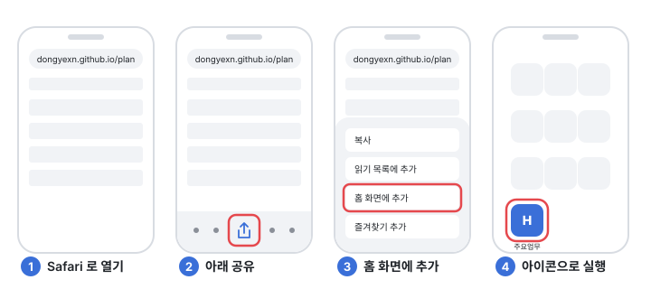
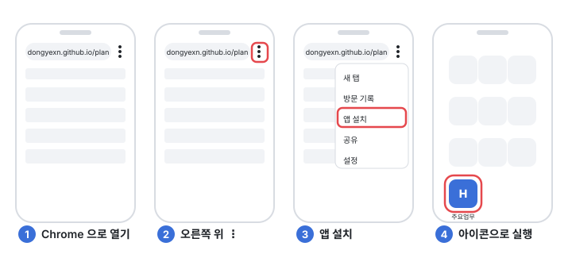

## 시작하기

1. `dongyexn.github.io/plan` 에서 회사 메일(`@hdec.co.kr`)로 가입
2. 인증 메일의 링크 누르기
3. 관리자에게 팀·담당 현장 배정 요청

**PC** — 설정 → 바탕화면 위젯 **다운로드** 후 실행

**아이폰** — Safari 로 열고 공유 → **홈 화면에 추가**

**안드로이드** — Chrome 으로 열고 ⋮ → **앱 설치**

## 캘린더

- **업무 추가** — 날짜를 누르고 「+」. 여러 날은 끌어서 선택

- **저장** — 적는 대로 저장됩니다. 그만두려면 X
- **완료·수정·삭제** — 업무를 우클릭
- **놓친 업무** — 다음 날 확인 창에서 완료 · 오늘로 · 날짜 변경
- **보류함** — 일자 패널 아래. 달력 날짜로 끌어 놓으면 되살아남
- **반복** — 매주 · 격주 · 매월 · 매년
- **찾기** — 맨 위 검색창 또는 `Ctrl+K`

## 업무 현황

- **주간 업무** — 목요일 ~ 수요일 기준. 이번 주 완료와 다음 주 예정
- **현장별 업무** — 그 달 업무를 현장별로(날짜·현장이 있는 업무만)
- **고치기** — 줄을 누르면 그 자리에서

## 주요 현안

- **보드** — 현장마다 카드 하나. 카드 머리 「+」로 현안을 적고 Enter(이어서 적을 수 있음)
- **해결** — 줄 앞 동그라미. 해결한 줄은 7일 뒤 보드에서 빠집니다
- **고치기 · 지우기** — 글자를 누르면 고치고, 줄을 우클릭(폰은 길게 누르기)해 「현안 지우기」로 지웁니다
- **D+N** — 적은 날부터 지난 날. 30일이 넘으면 주황
- **새 현안** — 적은 지 하루가 안 된 줄 앞에 파란 점
- **내 화면 정리** — 카드 머리를 잡고 끌어 자리를 바꾸고, 머리를 두 번 눌러 접습니다. 탭 줄 오른쪽 정렬 단추로 기본(권역·담당자)·진행 많은 순·오래된 현안 순·내 현장 먼저·내가 놓은 순서, 「현안 없는 현장 접기」. 내 계정에만 적용됩니다
- **현장 빼기 · 넣기** — 카드를 우클릭해 「보드에서 빼기」, 탭 줄 오른쪽 「+」로 보드에 없는 현장(하자 화면에서 꺼 둔 현장 포함)을 넣습니다. 팀 모두의 보드에 같이 적용됩니다
- **위젯** — 머리 줄 주요 현안 단추(목록 판 아이콘)를 누르면 달력 자리가 주요 현안으로 바뀝니다(다시 누르거나 달을 넘기면 달력). 설정의 「4주 + 주요 현안」을 켜면 달력은 전주·금주·담주·다담주만, 아래에 내 담당 현장 카드 한 줄(카드가 많으면 옆으로 넘김)

팀 모두가 함께 보고 고치는 기록입니다.

## 업무 도구

- **D+60 점검** — 폰에서 공간별로 양호 · 지적 · N/A 를 누르고 사진을 찍습니다. 다 봤으면 위 「점검 완료」. 엑셀 · 사진대지는 데스크톱에서
- **사진대지 작성** — 사진을 끌어 놓으면 A4 에 2 · 4 · 6칸으로
- **견적 검토** — 산출 근거 열을 붙여 넣으면 계산식을 검산
- **재하자 추적 · 생산성 검토** — 「전체 하자 목록」 엑셀을 열기

D+60 점검만 팀이 함께 보는 기록입니다. 나머지 도구에 올린 파일은 이 PC 에만 남습니다.

## 하자처리 현황

- **대시보드** — 팀 전체 접수 · 처리 · 미처리 · 장기미처리(기준월 말일 기준)
- **현장** — 장기미처리 · 공가 · 상세 · 민원 현황. 처리계획은 여기서 입력
- **회의 모드** — 위 「회의 모드」 단추. ← → 로 장을 넘깁니다

- **자료 올리기** — 관리자가 설정에서 HCS 원본을 올리고 [등록]

## 위젯 · 설정

- **위젯** — 날짜를 누르면 옆에 업무 패널. 위치·크기는 설정의 「위치·크기 조정」을 켠 동안만 바뀝니다
- **배경화면** — 설정 → 배경화면. 기본은 들어올 때마다 무작위로 바뀝니다(지난번 사진은 빼고). 끄고 마음에 드는 사진을 고를 수 있습니다

- **휴지통** — 지운 업무는 30일 보관

## 문제 해결

| 이럴 때 | 이렇게 |
|---|---|
| 저장이 안 됨 | 관리자에게 권한 확인 요청 |
| 화면이 예전 모습 | `Ctrl+Shift+R` · 폰은 아이콘을 지우고 다시 추가 |
| 위젯이 안 뜸 | `문서\H 주요업무현황\HPlanWidgetLite.exe` 실행 |
| 오류를 알릴 때 | 설정 화면 오른쪽 위 **버전 번호**를 눌러 복사 → 관리자에게 |

